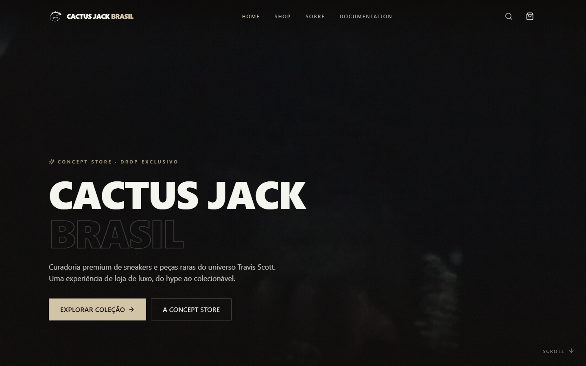
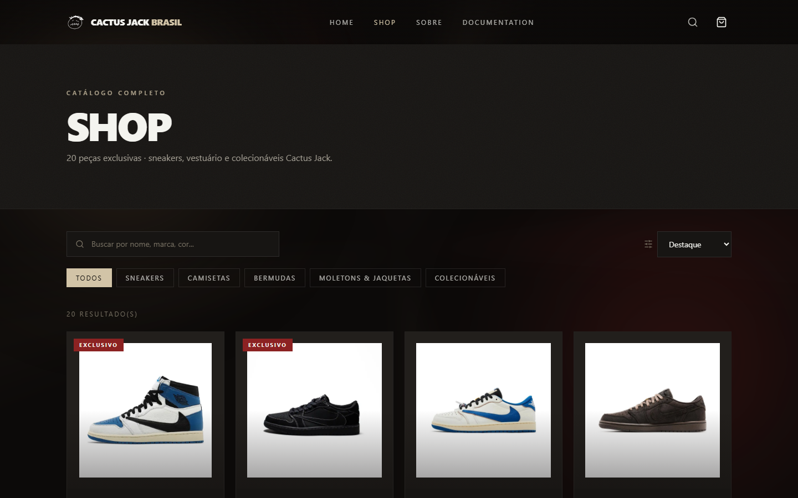
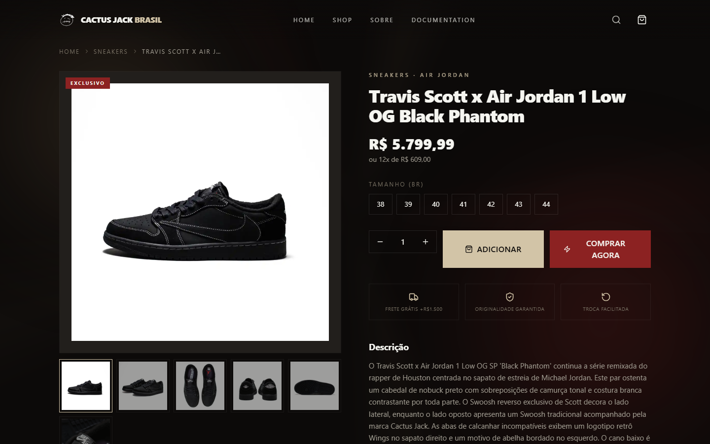
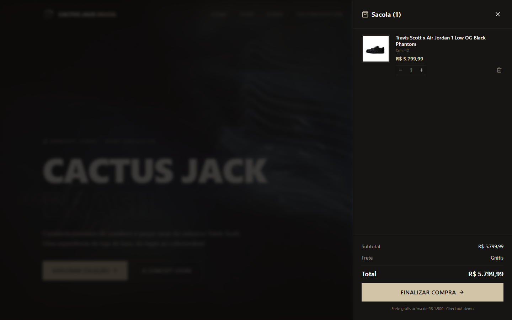
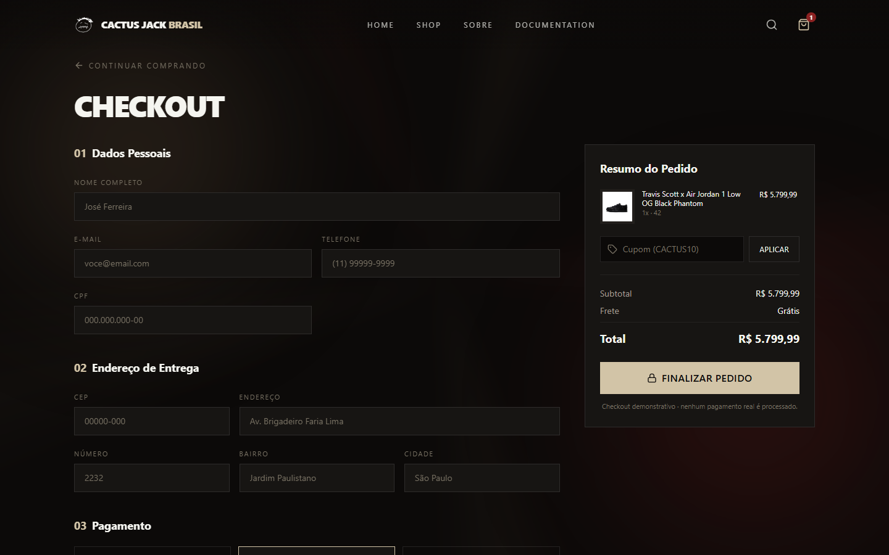
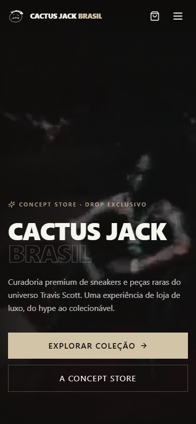

# Cactus Jack Brasil — Sneaker Concept Store

## Overview

Cactus Jack Brasil is a premium sneaker and streetwear concept store created as a Sick Code showcase. It presents an immersive ecommerce-style experience with editorial visuals, product galleries, frontend cart interactions, demo checkout, responsive layouts, and motion-driven storytelling.

The project is designed as a portfolio-grade static storefront and can be deployed as part of the Sick Code Showcase.

## Live Preview

Live preview will be available after deployment on Sick Code.

Repository: https://github.com/realjoseferreira/cactus-jack-brasil

## Screenshots













## Features

- Premium landing page with video-backed hero
- Product catalog with filtering, sorting, categories, and search
- Product detail pages with gallery images and related products
- Frontend cart drawer with quantity controls and size variants
- localStorage cart persistence
- Demo checkout flow with simulated order confirmation
- Responsive desktop, tablet, and mobile layouts
- 3D hover interactions on supported pointers
- Documentation page explaining the technical structure
- Sick Code footer credit and external portfolio link

## Tech Stack

- React 19
- JavaScript / JSX
- Create React App with CRACO
- React Router 7
- Tailwind CSS 3
- Framer Motion
- Lucide React
- Sonner
- React Context API
- localStorage
- HTML5 video
- FastAPI scaffold in `backend/` (not used by the storefront checkout)

## Project Structure

```text
.
├── backend/
│   ├── requirements.txt
│   └── server.py
├── docs/
│   └── screenshots/
├── frontend/
│   ├── public/
│   │   ├── brand/
│   │   └── products/
│   └── src/
│       ├── components/
│       ├── context/
│       ├── data/
│       ├── lib/
│       └── pages/
└── README.md
```

## Product Assets Logic

Product records are stored in `frontend/src/data/catalog.json`. The frontend enriches those records in `frontend/src/lib/catalog.js`, calculating availability, badges, featured products, latest drops, category counts, and related products.

Images are served from `frontend/public/products/<product-slug>/`. Each product uses a main image and optional gallery images. Brand-level assets, video files, logo, icon, and hero poster live in `frontend/public/brand/`.

## Cart and Checkout

The cart is frontend-only and managed by `frontend/src/context/CartContext.jsx`. It persists to `localStorage` using the `cjb_cart_v1` key, supports quantity updates, size variants, removal, simulated shipping, and visual coupon logic.

Checkout is a demo flow. It does not create backend orders, process payments, or connect to a real payment provider.

## Performance Notes

- Non-critical images use lazy loading and async decoding through `SmartImage`
- Critical hero media displays a poster immediately to avoid layout shift
- Hero video loading is deferred, connection-aware, muted, looped, inline, and split into mobile/desktop files
- Product cards and product detail galleries use stable aspect-ratio containers
- Secondary routes are code-split with `React.lazy`
- Mobile interactions skip expensive 3D tilt behavior on coarse pointers
- External preview scripts, badges, and tracking snippets were removed

## Installation

```bash
cd frontend
npm install --legacy-peer-deps
npm run dev
```

`npm start` is also available as an alias for the same local development server.

Create a production build:

```bash
cd frontend
npm run build
```

## Deployment

The storefront can be built and hosted as a static site from `frontend/build`.

This project is intended to be deployed as part of the Sick Code Showcase.

## Disclaimer

This is an unofficial concept store created for portfolio and design demonstration purposes only. It is not affiliated with Travis Scott, Cactus Jack, Nike, Jordan Brand, Fragment Design, McDonald's, WWE, or any official brand owner.

## Credits

Developed by José Ferreira

